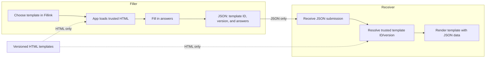

# Fillink

**Forms as code. Submissions as data.**

Fillink is an open-source experiment in data-first forms. A form's presentation is an HTML template; a completed submission is structured JSON that identifies the template and version needed to render it. The goal is to make forms easier to automate, validate, share in bulk, and sign.

## Repository status

Early scaffold. The submission format is a draft; the local Fillink app supports only the DA Form 5960 and DA Form 705-AFT templates. There is not yet a production-grade renderer, signing implementation, or compatibility guarantee. See [`docs/format.md`](docs/format.md) for the current model and open design questions.

## What's here

- [`.agents/skills/pdf-to-fillink/SKILL.md`](.agents/skills/pdf-to-fillink/SKILL.md) — repeatable workflow for adding one HTML template and one JSON example from a supplied PDF.
- [`assets/fillink-base.css`](assets/fillink-base.css) — common presentation styles loaded by the app.
- [`app/`](app/) — the single Fillink application: trusted HTML resolution, shared styling, data binding, validation, Save/Load/Lock, CSV, and ZIP workflows.
- [`templates/`](templates/) — one self-contained HTML file per trusted form; templates contain no JavaScript or external assets.
- [`examples/da-form-5960.json`](examples/da-form-5960.json) and [`examples/da-form-705-aft.json`](examples/da-form-705-aft.json) — synthetic Fillink submission examples.
- [`spec/submission.schema.json`](spec/submission.schema.json) — draft JSON Schema for a Fillink submission envelope.
- [`docs/forms/`](docs/forms/) — source notes, conversion adaptations, and limitations for the two Army form examples.

## Core idea

```text
Fillink app + one versioned HTML template + one JSON submission -> rendered form
```

A submission should carry answers, not a duplicate of the presentation. It must also identify the exact template version; a mutable URL alone is not sufficient for reliable re-rendering or signing. Fillink does not yet define a signing format. CAC/PIV support must be designed to interoperate with existing PKI and organizational requirements rather than inventing a proprietary signature scheme.

## Share data, not the whole form



Each form is one versioned HTML file with its presentation markup, metadata, and `data-fillink` bindings. Common styling and all application logic live in Fillink. When opening a submission, the app resolves the template ID/version through a trusted allowlist and fetches only that HTML file; the template cannot load arbitrary scripts, stylesheets, or assets. The JSON submission carries its template reference and answers, not a duplicate of the presentation.

## Development

Run the local Fillink app from the repository root:

```sh
python3 -m http.server 8000 --bind 127.0.0.1
```

Open <http://localhost:8000/app/>. Start a blank template, open a JSON submission, or use a same-origin direct link such as <http://localhost:8000/app/?submission=../examples/da-form-705-aft.json>. The app uses a trusted allowlist and fetches only the referenced HTML template. This prototype has no build system or third-party runtime dependencies.

## License

Not selected yet. Choose a license before accepting contributions or distributing the project.
